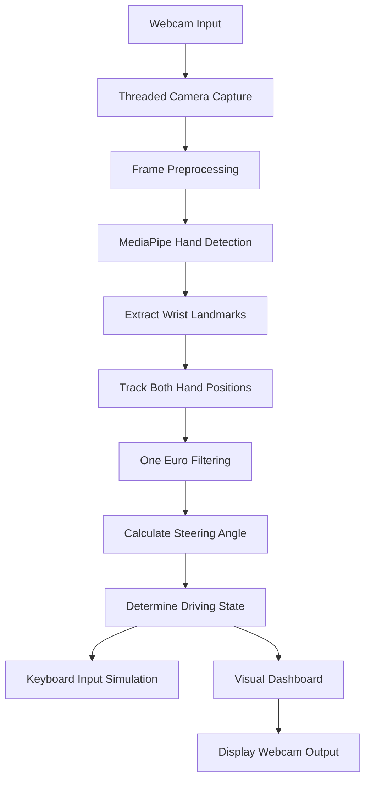

# Virtual Steering Wheel

<p align="center">
  <strong>Control Driving Games Using Hand Gestures and Computer Vision</strong>
</p>

<p align="center">
  A real-time virtual steering wheel built with Python, OpenCV, and MediaPipe.
  Turn your hands to steer, raise them to accelerate, and lower them to brake — all through your webcam.
</p>

<p align="center">
  
  
  
  
  
</p>

---

## About the Project

**Virtual Steering Wheel** is a computer vision-based game controller that transforms hand movements into keyboard inputs.

Instead of using a physical keyboard or steering wheel, the application uses a webcam to detect both hands and interpret their positions as driving controls.

The system identifies wrist landmarks using MediaPipe, calculates the angle between the two wrists, and translates that angle into steering commands. Vertical hand movement is used to control acceleration and braking.

The application also includes automatic calibration, gesture-based recalibration, motion smoothing, keyboard debouncing, threaded camera capture, and a real-time visual dashboard.

The primary goal is to create an interactive and responsive driving-game control experience using only a webcam and Python.

### Key Highlights

- Real-time two-hand tracking.
- Virtual steering wheel with dynamic rotation.
- Gesture-based left and right steering.
- Hand-position-based acceleration and braking.
- Automatic and manual steering calibration.
- Gesture-based recalibration.
- One Euro Filter for smoother tracking.
- Low-latency threaded webcam processing.
- Keyboard simulation for driving games.
- Real-time FPS, steering angle, and lock percentage display.
- Webcam failure detection and reconnection attempts.

## Key Features

### 1. Real-Time Hand Detection

Uses MediaPipe Hands to detect hand landmarks from webcam frames.

- Tracks up to two hands.
- Extracts wrist coordinates.
- Uses hand landmarks to determine steering position.
- Draws hand connections on the camera feed.
- Requires both hands for active steering and driving controls.

### 2. Virtual Steering Wheel

Creates a visual steering wheel using the positions of both wrists.

- Calculates the midpoint between the wrists.
- Determines the steering angle using trigonometry.
- Draws a dynamically rotating steering wheel.
- Displays left, right, and straight steering states.
- Limits the displayed angle to a maximum of 90 degrees.

### 3. Steering Control

The application calculates the angle between the left and right wrist positions.

Based on the calculated angle, the system determines whether the user is turning left, turning right, or maintaining a straight position.

| Steering State | Action |
|---|---|
| LEFT | Left arrow key |
| RIGHT | Right arrow key |
| STRAIGHT | No steering key |

The steering logic uses separate entry and exit thresholds to reduce unwanted switching around the center position.

### 4. Acceleration and Braking

Vertical wrist position determines acceleration and braking.

- **Acceleration:** Both hands move above the acceleration threshold.
- **Braking:** Both hands move below the braking threshold.
- **Coasting:** Neither condition is active.

The application uses the average vertical position of both wrists to determine the current driving state.

| Gesture | Keyboard Input |
|---|---|
| Raise both hands | Up Arrow |
| Lower both hands | Down Arrow |
| Keep hands between thresholds | No acceleration or braking input |

### 5. Automatic Calibration

The system automatically establishes a neutral steering position after detecting both hands for a specified period.

This helps adapt the steering center to the user's natural hand position.

### 6. Gesture-Based Recalibration

The application supports recalibration without using the keyboard.

1. Bring both hands close together.
2. Hold the gesture briefly.
3. Move your hands apart into your normal driving position.
4. Hold the new position.
5. The application establishes a new steering center.

### 7. Motion Smoothing

Uses a custom implementation of the **One Euro Filter** to reduce unwanted movement in detected wrist coordinates and steering angles.

This helps reduce jitter and makes steering more stable.

### 8. Keyboard Input Simulation

Translates detected gestures into keyboard events.

The application supports two input methods:

- `keyboard` library for direct keyboard event handling.
- `PyAutoGUI` as a fallback when the optional `keyboard` library is unavailable.

### 9. Threaded Camera Processing

Uses a separate background thread to capture webcam frames.

This helps keep camera capture independent of the main hand-detection and rendering loop.

Additional functionality includes:

- Camera initialization checks.
- Frame buffering.
- Camera reconnection attempts.
- Recovery from temporary frame capture failures.

### 10. Real-Time Visual Dashboard

The webcam window displays useful information while the application is running.

| Display Element | Description |
|---|---|
| Hand Landmarks | Detected hand connections |
| Virtual Steering Wheel | Visual steering representation |
| Steering State | LEFT, RIGHT, or STRAIGHT |
| Steering Angle | Current calculated angle |
| Lock Meter | Steering lock percentage |
| Driving Status | ACCELERATING, BRAKING, or COASTING |
| FPS Counter | Current processing frame rate |
| Hand Detection Status | Indicates whether both hands are detected |
| Calibration Status | Displays calibration progress |

---

## Technology Stack

| Technology | Purpose |
|---|---|
| Python | Core application and control logic |
| OpenCV | Webcam capture, image processing, and visualization |
| MediaPipe | Real-time hand landmark detection |
| NumPy | Coordinate calculations and geometric drawing |
| PyAutoGUI | Keyboard input simulation |
| Keyboard | Optional low-latency keyboard event handling |
| Threading | Background webcam frame capture |
| Math | Steering angle and geometric calculations |
| Time | Frame timing, calibration, and debounce management |

## System Architecture

The application follows a real-time processing pipeline.



### Processing Pipeline

**1. Webcam Capture**

OpenCV initializes the camera and captures frames using a dedicated background thread.

**2. Frame Preprocessing**

The captured frame is flipped horizontally, resized for processing, and converted from BGR to RGB.

**3. Hand Detection**

MediaPipe processes the resized frame and identifies hand landmarks.

**4. Wrist Extraction**

The application extracts wrist coordinates from both detected hands.

**5. Position Tracking**

The system maintains consistent left and right wrist assignments between consecutive frames by comparing movement distances.

**6. Motion Filtering**

The One Euro Filter smooths wrist coordinates and steering-angle measurements.

**7. Driving State Calculation**

The application calculates steering direction, acceleration, and braking conditions.

**8. Keyboard Simulation**

The corresponding arrow keys are pressed and released based on the detected driving state.

**9. Visual Rendering**

The processed frame is displayed with the steering wheel, hand landmarks, angle, FPS, and driving status.

---

## Steering Algorithm

The steering system uses the geometric relationship between two wrist positions.

Let:

- \(L(x_1,y_1)\) represent the left wrist.
- \(R(x_2,y_2)\) represent the right wrist.

The angle is calculated using:

\[
\theta = \tan^{-1}\left(\frac{y_2-y_1}{x_2-x_1}\right)
\]

The angle is converted from radians to degrees.

The application then subtracts the calibrated neutral angle to obtain the relative steering angle.

### Steering State Detection

The application uses two thresholds:

- `TURN_ENTER_DEG`: Threshold for starting a turn.
- `TURN_EXIT_DEG`: Threshold for returning to straight.

This creates hysteresis, which prevents rapid switching between steering states.

Default values:

| Parameter | Value |
|---|---:|
| Turn Entry Angle | 10° |
| Turn Exit Angle | 5.5° |
| Maximum Display Angle | 90° |

### Acceleration and Braking Logic

The average wrist height is calculated as:

\[
Y_{avg} = \frac{y_1+y_2}{2}
\]

The application compares this value against two thresholds.

| Parameter | Default Value |
|---|---:|
| Acceleration Threshold | 72% of frame height |
| Braking Threshold | 90% of frame height |

A smaller vertical coordinate represents a higher position in the image.

---

## Motion Filtering and Responsiveness

### One Euro Filter

The project implements a custom One Euro Filter to reduce noise in hand tracking.

The filter uses:

- Minimum cutoff frequency.
- Adaptive beta parameter.
- Derivative filtering.
- Time-based smoothing.

The adaptive cutoff helps preserve responsiveness during faster movements while reducing jitter during slower movements.

Default filter settings:

| Parameter | Value |
|---|---:|
| Steering Minimum Cutoff | 1.3 |
| Steering Beta | 0.65 |
| Wrist Minimum Cutoff | 1.0 |
| Wrist Beta | 0.7 |

### Keyboard Debouncing

The application uses a debounce interval before changing keyboard states.

This prevents rapid repeated key transitions caused by small fluctuations in detected hand movements.

Default debounce interval: `0.12 seconds`.

### Camera Processing

The application uses the following default camera settings:

| Parameter | Value |
|---|---:|
| Camera Index | 0 |
| Frame Width | 960 |
| Frame Height | 720 |
| Processing Scale | 0.6 |
| Maximum Camera Reconnect Attempts | 5 |

---

## Project Structure

```text
steering-wheel/
│
├── steering_wheel.py       # Main application
├── requirements.txt        # Python dependencies
├── README.md               # Project documentation
├── .gitignore              # Ignored files and folders
│
└── venv/                   # Local Python environment
                            # Not committed to GitHub
```

The project is currently implemented as a single Python application, with camera handling, hand detection, filtering, steering logic, keyboard control, and visualization contained in `steering_wheel.py`.

---

## Installation and Setup

### Prerequisites

Before installing the project, make sure you have:

- Python installed.
- A working webcam.
- Windows recommended for the current camera and keyboard configuration.
- A compatible driving game that accepts keyboard input.
- Internet access for installing Python dependencies.

### 1. Clone the Repository

```bash
git clone https://github.com/tejass23106/steering-wheel.git
```

Navigate into the project directory:

```bash
cd steering-wheel
```

### 2. Create a Virtual Environment

```bash
python -m venv venv
```

### 3. Activate the Virtual Environment

For Windows PowerShell:

```powershell
.\venv\Scripts\Activate.ps1
```

For Windows Command Prompt:

```cmd
venv\Scripts\activate
```

### 4. Upgrade pip

```bash
python -m pip install --upgrade pip
```

### 5. Install Dependencies

```bash
pip install -r requirements.txt
```

### 6. Run the Application

```bash
python steering_wheel.py
```

The webcam window should open and begin detecting both hands.

---

## How to Use

### Initial Setup

1. Connect your webcam.
2. Close other applications that may be using the camera.
3. Activate the virtual environment.
4. Run `steering_wheel.py`.
5. Position both hands in front of the webcam.
6. Wait for automatic calibration.
7. Use hand movements to control a compatible driving game.

### Gesture Controls

| Hand Movement | Result |
|---|---|
| Tilt both hands left | Steer left |
| Tilt both hands right | Steer right |
| Keep hands at calibrated center | Steer straight |
| Raise both hands | Accelerate |
| Lower both hands | Brake |
| Bring hands together and move apart | Recalibrate |

### Keyboard Controls

| Key | Function |
|---|---|
| `Q` | Quit application |
| `C` | Manually recalibrate steering |
| `Ctrl + C` | Stop application from terminal |

---

## Configuration and Customization

Several parameters can be adjusted directly in `steering_wheel.py`.

### Camera Settings

```python
CAM_INDEX = 0
FRAME_W, FRAME_H = (960, 720)
PROCESS_SCALE = 0.6
```

Change the camera index if your system has multiple webcams.

### Steering Sensitivity

```python
TURN_ENTER_DEG = 10
TURN_EXIT_DEG = 5.5
TURN_MAX_DEG = 90
```

Adjust these values to change steering sensitivity and the maximum displayed steering angle.

### Acceleration and Braking

```python
ACCEL_Y_RATIO = 0.72
BRAKE_Y_RATIO = 0.9
```

Adjust these ratios to change the hand positions required for acceleration and braking.

### Keyboard Mapping

```python
KEY_LEFT = 'left'
KEY_RIGHT = 'right'
KEY_UP = 'up'
KEY_DOWN = 'down'
```

These values define the keyboard inputs sent to the game.

### Motion Filtering

```python
ONE_EURO_MIN_CUTOFF = 1.3
ONE_EURO_BETA = 0.65

POINT_MIN_CUTOFF = 1.0
POINT_BETA = 0.7
```

These parameters control smoothing for steering angles and wrist coordinates.

### Calibration Settings

```python
AUTO_CALIBRATE_DELAY_SEC = 2.5
GESTURE_CALIBRATE_DISTANCE_RATIO = 0.22
GESTURE_CALIBRATE_HOLD_SEC = 0.5
```

These settings control automatic calibration and gesture-based recalibration.

---

## Troubleshooting

### 1. Webcam Not Detected

**Possible causes:**
- Another application is using the webcam.
- Incorrect camera index.
- Camera permissions are disabled.
- Webcam drivers are unavailable.

**Solutions:**
- Close applications such as Zoom or Teams.
- Check the camera connection.
- Try another `CAM_INDEX`.
- Verify Windows camera permissions.

### 2. MediaPipe Installation Issues

**Possible causes:**
- Unsupported Python version.
- Incompatible package version.
- Incomplete dependency installation.

**Solutions:**

```bash
python --version
python -m pip install --upgrade pip
pip install -r requirements.txt
```

If installation still fails, use a Python version supported by the selected MediaPipe release.

### 3. Hands Are Not Detected

**Solutions:**
- Improve room lighting.
- Keep both hands visible.
- Avoid covering the wrists.
- Maintain a suitable distance from the webcam.
- Ensure the webcam is focused.

### 4. Steering Is Too Sensitive

Adjust:

```python
TURN_ENTER_DEG = 10
TURN_EXIT_DEG = 5.5
```

Increasing the entry threshold makes steering less sensitive.

### 5. Keyboard Inputs Are Not Working

**Solutions:**
- Check whether the game accepts arrow-key controls.
- Ensure the game window is active.
- Check whether the optional `keyboard` library is installed.
- Try the PyAutoGUI fallback.
- Check system permissions for keyboard simulation.

### 6. Low FPS or Delayed Response

**Solutions:**
- Close unnecessary background applications.
- Improve webcam lighting.
- Try reducing `PROCESS_SCALE`.
- Use a suitable camera resolution.
- Check CPU usage.

---

## Current Project Status

| Component | Status |
|---|---|
| Webcam Capture | Implemented |
| Two-Hand Detection | Implemented |
| Wrist Landmark Tracking | Implemented |
| Virtual Steering Wheel | Implemented |
| Left and Right Steering | Implemented |
| Acceleration and Braking | Implemented |
| Automatic Calibration | Implemented |
| Gesture Recalibration | Implemented |
| One Euro Filtering | Implemented |
| Keyboard Simulation | Implemented |
| Real-Time Dashboard | Implemented |
| Camera Reconnection | Implemented |

---

## Known Limitations

- Requires a working webcam.
- Both hands must be visible for active driving controls.
- Detection accuracy depends on lighting and camera positioning.
- Performance depends on available CPU resources and camera frame rate.
- Keyboard simulation behavior can vary depending on the game and operating-system permissions.
- The application currently uses fixed gesture thresholds rather than a graphical settings interface.
- The current implementation is designed for keyboard-controlled games, not physical vehicle operation.

## Future Improvements

Potential improvements for future versions include:

- Graphical configuration interface.
- Adjustable steering sensitivity.
- Customizable keyboard mappings.
- Support for additional hand gestures.
- Improved tracking under different lighting conditions.
- Better camera selection and configuration.
- More advanced filtering and responsiveness controls.
- Game-specific control profiles.
- Performance monitoring and calibration visualization.

---

## Safety Notice

This project is intended for experimentation and controlling compatible video games.

It simulates keyboard inputs and is not designed or approved to control real vehicles, steering systems, or automotive hardware.

Use it only in a safe environment.

---

## Contributing

Contributions, suggestions, and improvements are welcome.

1. Fork the repository.
2. Create a feature branch.
3. Make your changes.
4. Test the application.
5. Submit a pull request.

---

## Author

**Tejas Kumar S**

- GitHub: [@tejass23106](https://github.com/tejass23106)

---

<p align="center">
  Built with Python, OpenCV, and MediaPipe.
</p>

<p align="center">
  <strong>Turn your hands into a steering wheel.</strong>
</p>